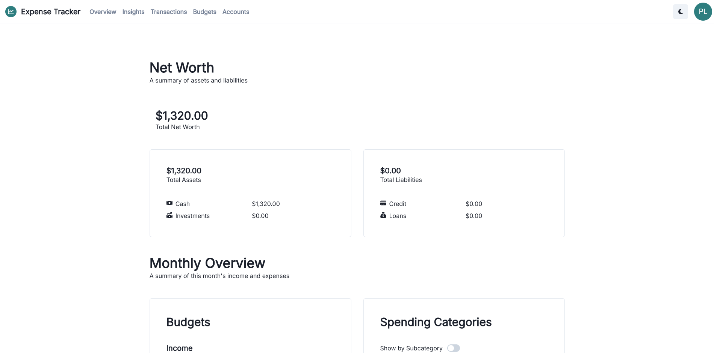
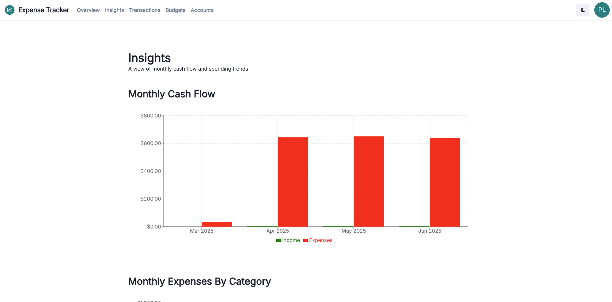
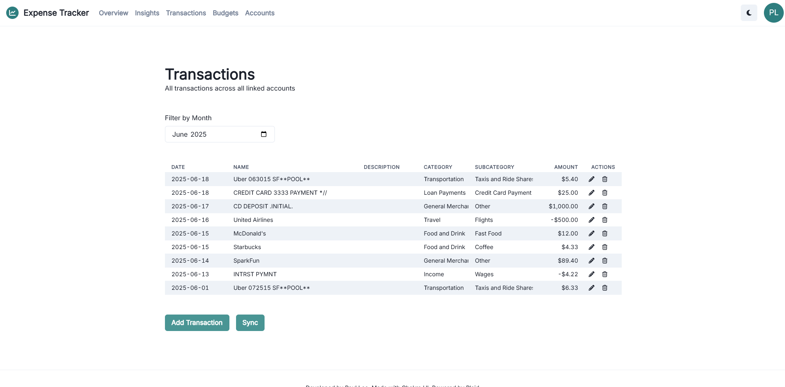
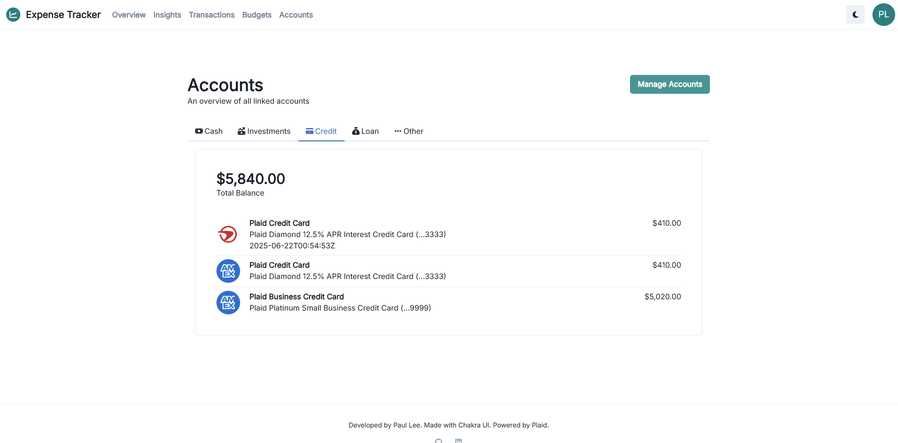

# Expense Tracker

A personal expense-tracking web application. Built with React.js, Express, Node.js, and DynamoDB.

Account transaction data provided by the [Plaid API](https://plaid.com/docs/).

## How to Run

### Development

To run the UI locally, run:

```bash
# ./client
npm start
```

The UI will be available at http://localhost:3000.

To run the server locally, run:

```bash
# ./server
aws login --profile expense-tracker
npm start
```

The server will be available at http://localhost:8080

### Deploying

The client directory is synced with Vercel to automatically deploy `master`.

To deploy the server to an existing AWS Lambda function, run these commands from `server`:

```bash
npm run clean
mkdir -p dist/db
npx esbuild lambda.ts --bundle --platform=node --format=cjs --outfile=dist/index.cjs
cp db/budget-seed-data.csv dist/db/budget-seed-data.csv
(cd dist && zip -r ../server.zip .)
aws lambda update-function-code \
  --function-name expense-tracker \
  --zip-file fileb://server.zip \
  --region us-east-2 \
  --profile expense-tracker
```

The Lambda runtime handler must be `index.handler`, and the function must already have its execution role, environment variables, and API Gateway integration configured. This command updates `$LATEST`; if API Gateway invokes a published version through an alias, publish a new version and move the alias after the update.

## Screenshots





